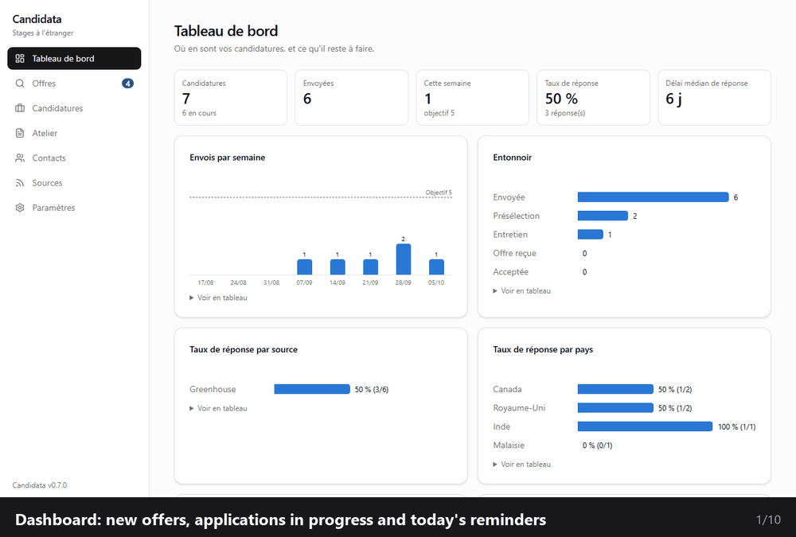
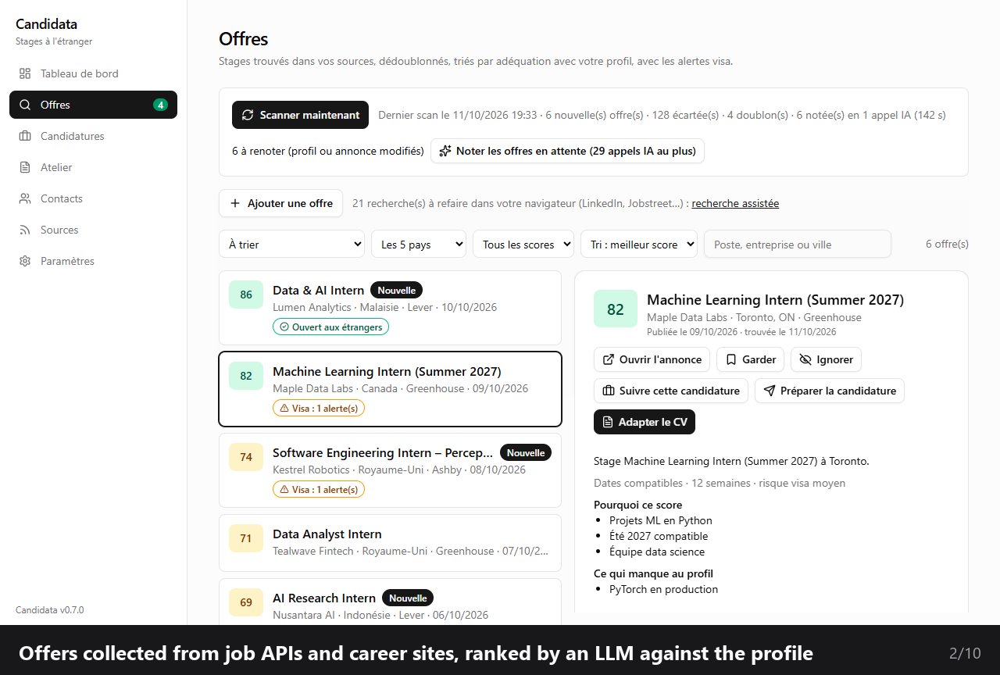
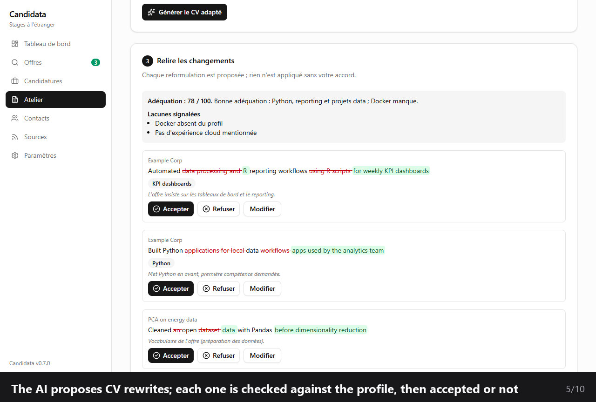
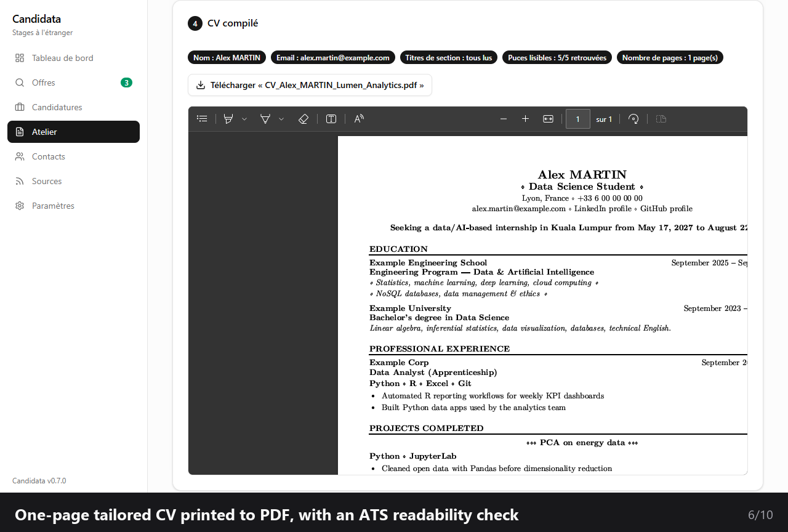
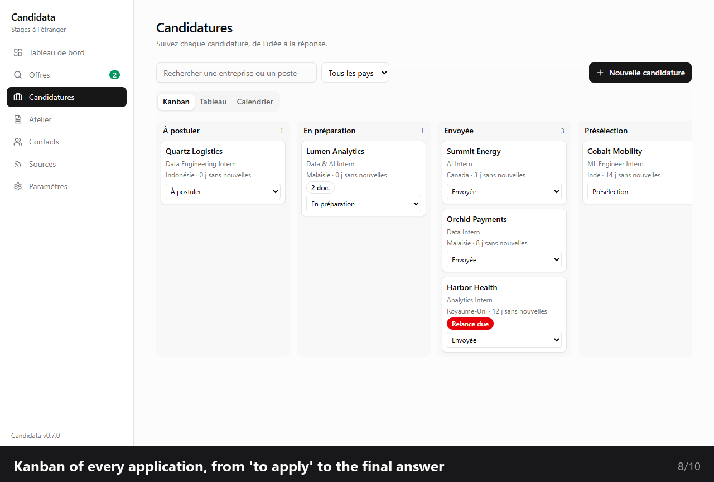
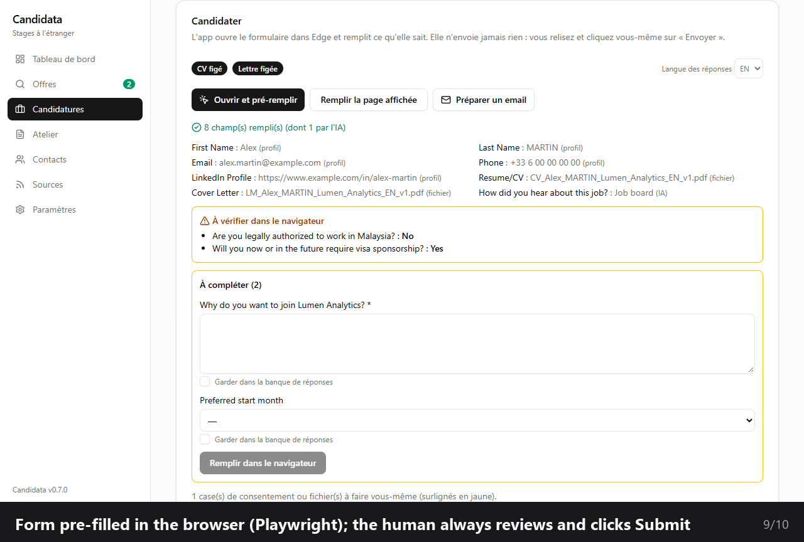
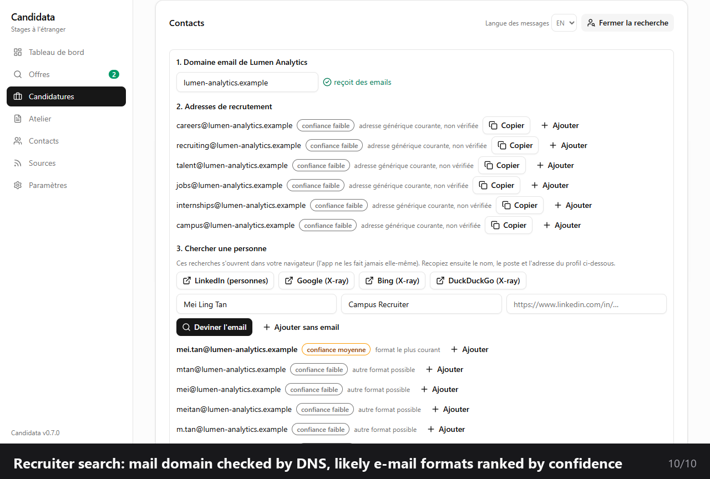
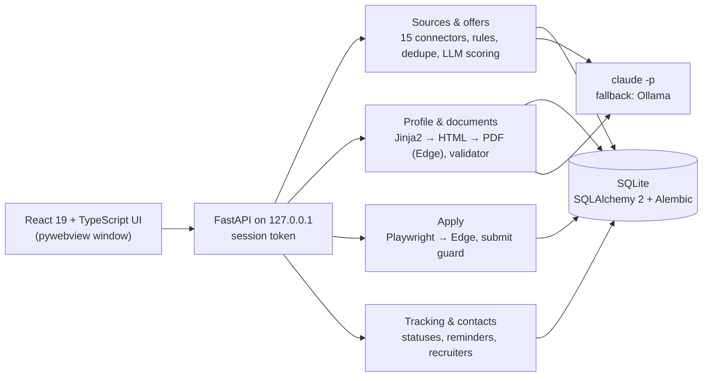

# Candidata

**A desktop app that automates an international internship search: it finds offers, ranks them with an LLM, tailors the CV and cover letter to each one under a fact-checking validator, pre-fills application forms and tracks every application.**

> **This repository is a showcase.** The source code is private; I am happy to give a live demo or
> walk through the code in an interview. Everything shown here runs on **fictional demo data**
> (example profile, invented companies and offers, simulated AI). The interface is in French.

## Why I built it

I am looking for a data/AI internship in five countries (Canada, United Kingdom, India, Malaysia,
Indonesia). Doing it by hand means checking dozens of job boards and company career sites every
week, reading hundreds of postings, rewriting the CV and the letter for each one and filling the
same forms again and again. I designed Candidata to automate the repetitive parts while keeping me
in charge of every decision that matters. It saves me 15+ hours a week.

## What it does

| Step | Candidata | Me |
|---|---|---|
| **Find** | Collects offers through 15 connectors (job APIs, company career sites), removes duplicates, filters them with rules and ranks them with an LLM | Read the shortlist |
| **Tailor** | Proposes CV and cover-letter rewrites for the offer; a deterministic validator blocks any invented number, skill or degree | Accept, edit or reject each change |
| **Apply** | Opens the application form in Edge and pre-fills it with Playwright | Review and click **Submit** (never automated) |
| **Follow up** | Kanban, reminders, recruiter search, GDPR-compliant messages | Send what I choose |

## A closer look

| | |
|---|---|
|  |  |
| **Offers** ranked against the profile, with reasons, gaps and visa alerts | **CV rewrites** proposed by the AI, each one reviewed before use |
|  |  |
| **One-page tailored CV** printed to PDF, with an ATS readability check | **Every application** tracked from "to apply" to the final answer |
|  |  |
| **Form pre-filling**: what was filled, what to check, what is left to the human | **Recruiter search**: mail domain checked by DNS, likely e-mail formats |

## Engineering highlights

- **Truthfulness by design**: every AI-generated sentence goes through a deterministic validator
  (numbers, years, technologies, degrees, seniority) before any PDF is produced.
- **Prompt-injection hygiene**: job postings are untrusted input, always wrapped and never obeyed.
- **Respect for websites**: no automated access to sites whose robots.txt or terms forbid it; a
  polite HTTP client (1 request/s per host, honest User-Agent) and circuit breakers per source.
- **Safety in the browser**: a guard class is the only way to act on a page and refuses any submit
  button; a static test forbids raw clicks anywhere else in the code.
- **Zero running cost**: LLM calls go through an existing Claude subscription (`claude -p`, structured
  JSON output), with a local Ollama model as fallback; only free API plans, keys kept in the Windows
  Credential Manager.
- **Quality gates**: 600+ automated tests (569 backend with pytest, 42 frontend with Vitest), ruff,
  GitHub Actions CI (lint, browser tests, PDF rendering, frontend build), pre-commit hooks (gitleaks
  and a private-data guard), Alembic migrations, recorded and anonymised fixtures for every connector.

## Architecture

| Layer | Technologies |
|---|---|
| Backend | Python 3.14, FastAPI, SQLAlchemy 2, Alembic, Pydantic v2, uv |
| Frontend | React 19, TypeScript, Vite, Tailwind v4, shadcn/ui, TanStack Query |
| Documents | Jinja2 HTML/CSS templates printed to PDF by Microsoft Edge, pypdf for the ATS check |
| Browser automation | Playwright driving the installed Edge |
| AI | Claude Code headless with JSON schemas, Ollama fallback, versioned prompts |

## In real use

After two weeks: 1,577 offers collected across 579 companies, 980 of them scored by the LLM, at
zero running cost.

## How it was built

I designed the product and directed its development with an AI coding assistant (Claude Code):
a plan in phases, every deviation from the plan recorded in a decision log, and tests green before
each step was declared done.

## Contact

Nayl Saifoudine · [LinkedIn](https://www.linkedin.com/in/nayl-saifoudine-5b0b31300/) ·
[other projects](https://github.com/Nayl-git)
